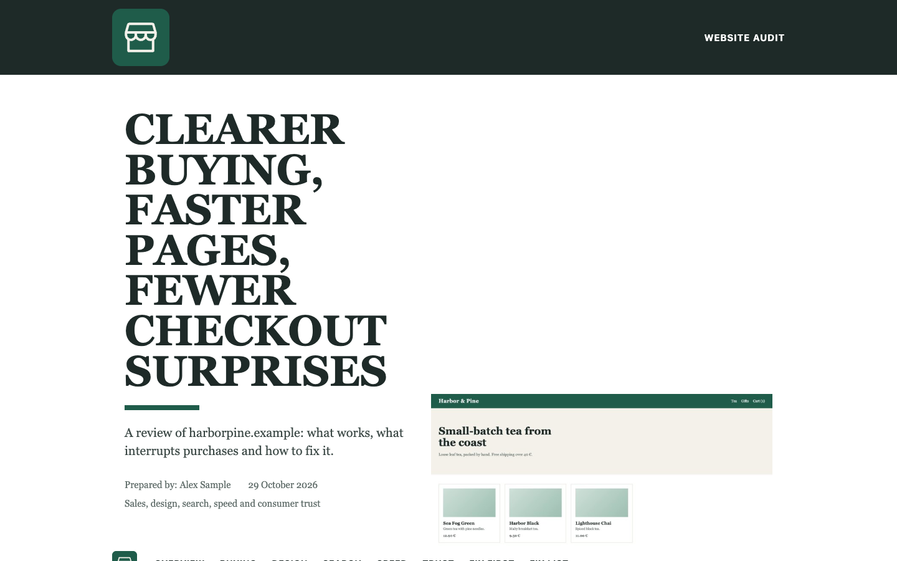
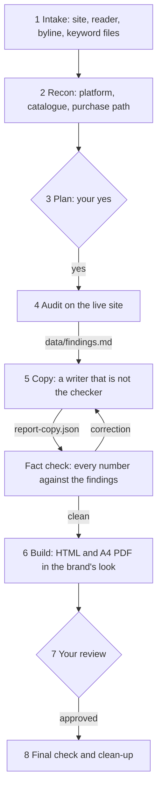

# Objective Brand Audit

A Claude Code skill that audits one website and makes a report in the brand's own look. You get an HTML file and
an A4 PDF. The skill checks each claim on the live site and gives each number a unit, a source and a date.



## Install

```bash
git clone https://github.com/BuildexLabsAI/objective-brand-audit.git
mkdir -p ~/.claude/skills
ln -s "$PWD/objective-brand-audit/src/objective-brand-audit" ~/.claude/skills/objective-brand-audit
```

Then start a new Claude Code session. A `git pull` in the clone updates the skill.

## Usage

Ask Claude Code in your own words:

```
Audit www.example.com and make a brand audit report
```

```
Objective brand audit of shop.example.com for a client
```

The skill asks a few questions in one message: the site, who gets the report, the name for the byline and the
keyword files (if you have them). It then shows a plan. It does no audit work before you say yes.

Another skill can run only phases 1–4 (intake, recon, plan, audit). These phases give the file
`data/findings.md`. [The Ex-Designer](https://github.com/BuildexLabsAI/ex-designer) uses the skill in this way.

## What it does



- Audits the sales path, the design, search visibility, speed and, for a web shop, EU consumer law.
- Takes screenshots on desktop (1440×900) and phone (375×812) in a real browser. It goes from the home page to the
  order button. It never places an order and never types personal data.
- Records what search bots, AI crawlers and link previews get from the site.
- Measures speed with Google PageSpeed Insights. When the quota is empty, it uses its own lab test with the
  Lighthouse mobile profile. The report then says that it is a lab test.
- Gives each area a grade: Excellent, Good, Needs work or Poor. Each area also shows what already works.
- If you give keyword files, it makes a keyword part: current strengths, monthly search curves, priority keywords
  and the page that must win each search.
- Gets the report text from a writer that is not the checker. It tries the Codex CLI first, then the OpenAI API,
  and then Claude with a copywriting skill. A script finds each number in the text that is not in the findings.
- Builds the report with the site's logo, colours and fonts. The report reads well on a phone.

## What it does not do

- It does not send the report to anyone. You decide who gets it.
- It does not change the site. The design audit only reports.
- It does not give legal advice. Each legal finding names its source, and the report tells the reader to ask a
  lawyer.
- It does not get past bot blocks, and it does not solve CAPTCHAs. When a site blocks a check, the skill stops and
  tells you.
- It does not write reports in languages other than English.

## Requirements

- Claude Code with a browser tool, for example the browser pane of the Claude desktop app or Claude in Chrome.
- Python 3 with Pillow and Playwright: `pip install pillow playwright`.
- Google Chrome. On Linux, or with Chrome in a different place, set `CHROME` to the path of the Chrome program.
- Poppler (`pdfinfo`, `pdftoppm`, `pdftotext`) to check the PDF pages.
- For the report text, one of these:
  - the Codex CLI (`codex`), signed in
  - `OPENAI_API_KEY` in the environment, for the OpenAI API (you can set the model with `OPENAI_MODEL`)
  - a copywriting skill for Claude, for example from
    [coreyhaines31/marketingskills](https://github.com/coreyhaines31/marketingskills)
- Optional: the skills `page-cro`, `seo-audit` and `redesign-existing-projects` for deeper checks. Without them,
  Claude does the same checks by hand.
- Optional: keyword files from a keyword tool, in the format of
  [`references/keyword-files.md`](src/objective-brand-audit/references/keyword-files.md).

## Run it locally

The tests use an invented tea shop in `tests/fixtures/` and do not use the network:

```bash
cd objective-brand-audit
bash .github/scripts/check-standard.sh
python3 tests/run_all.py
```

`run_all.py` takes about 10 seconds and opens Chrome without a window. All 19 checks must pass. The sample report is
then in `tests/out/sample-audit/outputs/`.

To make the README pictures again, run the tests first, then:

```bash
python3 scripts/readme_images.py
```

## Deploy

There is no server. To install the skill, link `src/objective-brand-audit/` to
`~/.claude/skills/objective-brand-audit` (see Install).

## Media and large files

The README pictures are in `docs/images/`. `scripts/readme_images.py` makes them. The report icons are from
[Phosphor Icons](https://phosphoricons.com) (MIT). There are no large files.

## First-time setup

Once per clone, activate the check that runs before each commit:

```bash
git config core.hooksPath .github/hooks
```

## License

MIT. See [LICENSE](LICENSE).

## Owner

@eskokoivula
